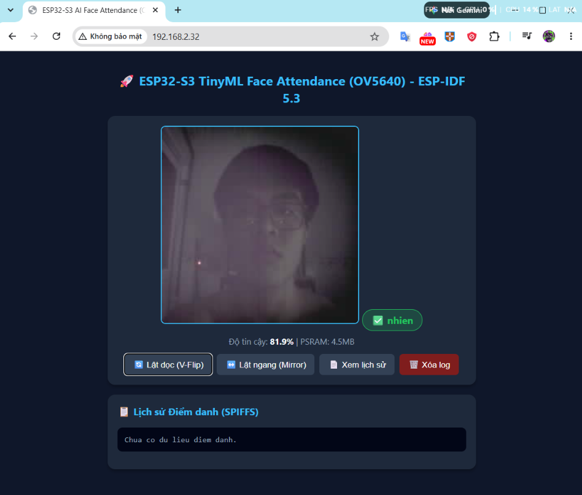

# Điểm danh khuôn mặt chạy độc lập trên ESP32-S3 (camera OV5640)

## 1. Project này làm gì?

Mình làm một thiết bị nhỏ để **điểm danh bằng khuôn mặt**. Thiết bị chạy hoàn toàn một mình trên chip **ESP32-S3 N16R8**, có gắn **camera OV5640**. Khi hoạt động thật thì **không cần cắm laptop hay camera IP** — chip tự làm hết.

Cách nó hoạt động, nói đơn giản:

1. Camera OV5640 chụp ảnh.
2. Chip tự tìm khuôn mặt trong ảnh (model **BlazeFace**).
3. Cắt khuôn mặt ra, thu nhỏ và chỉnh đều sáng (còn 64x64, ảnh xám).
4. Đưa ảnh đó qua model **Ghost-TinyFace** để đổi khuôn mặt thành một dãy **128 số** (mình gọi là "vector đặc trưng").
5. So dãy số này với dãy số của những người đã lưu trước, xem giống ai nhất.
6. Kết quả:
   - Đúng người: **LED xanh sáng + 1 tiếng bíp ngắn**, ghi tên vào file điểm danh.
   - Người lạ: **LED đỏ chớp + 2 tiếng bíp dài**.
7. Nếu có Wi-Fi: mở web để xem camera trực tiếp, xem tên đang nhận diện và tải danh sách điểm danh.

Ảnh minh họa web dashboard chạy thật trên ESP32-S3:



---

## 2. Sơ đồ thư mục (có giải thích)

```
PROJECT_5_DIEM_DANH_KHUON_MAT/
├── assets/                  # Ảnh minh họa, ảnh demo
├── firmware_esp32/          # Code chạy trên chip ESP32-S3 (C++ / ESP-IDF)
├── host_laptop/             # Code Python chạy trên laptop (test, thu ảnh, camera test)
├── training_tinyml/         # Code huấn luyện AI + tạo dữ liệu khuôn mặt
├── test_camera_.../         # Bản mẫu test camera gốc (để tham khảo)
├── tools/                   # Script nạp firmware 1 chạm
├── data/                    # Ảnh khuôn mặt đã thu + dữ liệu điểm danh
├── colab.zip                # Gói code để train trên Google Colab
├── HUONG_DAN_COLAB_TRAIN_*.md  # Hướng dẫn train model trên Colab
├── kich_hoat_moi_truong.md  # Các lệnh chạy nhanh
├── mo_ta_project.md         # Mô tả chi tiết từng file
├── ket_qua_*.txt            # Log chạy thật (laptop / ESP32 / camera)
└── requirements.txt         # Thư viện Python cần cài
```

**3 phần chính:**

- `firmware_esp32/` — "bộ não" chạy trên chip.
- `host_laptop/` — dùng trên laptop để test và thu ảnh, không phải phần chạy thật.
- `training_tinyml/` — nơi "dạy" AI và tạo dữ liệu khuôn mặt.

---

## 3. Thông số chính (dễ hiểu)

| Thành phần | Thông tin |
|---|---|
| Chip | ESP32-S3 N16R8 (16MB bộ nhớ trong, 8MB RAM ngoài PSRAM), chạy 240MHz |
| Camera | OV5640 gắn trực tiếp trên board, chụp ảnh 240x240 |
| Đèn - còi | Còi ở chân GPIO 1, LED xanh GPIO 2, LED đỏ GPIO 3 |
| Web | Mở ở cổng 80, xem `http://<IP-của-ESP32>/` (xem camera, xem điểm danh, tải file điểm danh) |
| Chế độ | Chạy độc lập 100%, không có Wi-Fi vẫn nhận diện bình thường |
| Tốc độ | Tìm mặt ~1.95 giây, nhận diện ~1.30 giây, mỗi vòng lặp ~1.32 giây/ảnh |
| Model nhận diện | Ghost-TinyFace 64x64 xám → 128 số, khoảng 160KB |
| Model tìm mặt | BlazeFace 128x128, khoảng 183KB |
| Cách so khớp | So với 16 mẫu/người, lấy điểm cao nhất (giống ai nhất), ngưỡng 0.70 (một số người 0.75) |
| Chống nhiễu | Phải đúng 3 ảnh liên tiếp mới chốt kết quả |
| Kết quả đo | Đúng 100% trên bộ dữ liệu mẫu, không nhận nhầm người |

---

## 4. Các giai đoạn đã làm

**Giai đoạn 1 — Làm hoàn chỉnh trên laptop**
- Train model trên Google Colab (miễn phí) với dữ liệu lớn CASIA-WebFace.
- Chạy thử toàn bộ quy trình trên laptop cho khớp với ESP32.
- Thu 20 ảnh mỗi người, mỗi người lưu 16 mẫu.
- Kết quả: nhận đúng 100% trên bộ mẫu.

**Giai đoạn 2 — Nén model cho nhẹ (INT8)**
- Đổi model từ dạng số thực nặng sang dạng số nguyên 8-bit cho nhẹ.
- Kiểm tra độ chính xác gần như không đổi (sai lệch rất nhỏ).
- Đưa model thành file `.h` để nhúng vào firmware.

**Giai đoạn 3 — Đưa lên ESP32-S3**
- Chuyển toàn bộ quy trình nhận diện xuống chip.
- Ban đầu dùng ảnh gửi từ laptop qua Wi-Fi, sau đó chuyển sang **camera OV5640 gắn trực tiếp**.
- Chia việc cho 2 nhân CPU: 1 nhân lo camera/mạng, 1 nhân lo AI.
- Làm LED, còi, ghi file điểm danh, thêm web server.

**Giai đoạn 4 — Tối ưu và hoàn thiện**
- Đã xong: tăng tốc (tìm mặt nhanh hơn ~10 lần, nhận diện nhanh hơn ~4 lần), chọn ngưỡng riêng cho từng người.
- Còn làm tiếp: chống giả mạo bằng ảnh in/màn hình, thêm giờ thật (NTP), nạp firmware không cần cáp (OTA), test thực tế nhiều người.

---

## 5. Trạng thái hiện tại

| Việc | Trạng thái |
|---|---|
| Train model V3 | Đã xong, nhận đúng 100% trên bộ mẫu |
| Test trên laptop | Đã xong |
| Thu ảnh 20 ảnh/người (nhien, thao, toan) | Đã xong |
| Nén model INT8 | Đã xong |
| Firmware ESP-IDF 5.3 chạy độc lập | Đã xong |
| Camera + tìm mặt + nhận diện trên chip | Đã xong |
| LED + còi + ghi điểm danh | Đã xong |
| Tăng tốc + chọn ngưỡng | Đã xong, đo trên chip thật |
| Chống giả mạo, OTA, test thực địa | Đang làm tiếp |

---

## 6. Vài nguyên tắc khi làm project này

1. **Thử trên laptop trước, đưa lên chip sau.** Mọi thay đổi phải test trên laptop cho khớp rồi mới nạp xuống ESP32.
2. **Giữ đúng "hợp đồng" xử lý ảnh:** laptop và ESP32 phải xử lý ảnh giống y hệt nhau (cùng cắt, cùng chỉnh sáng, cùng cách tính) để kết quả không lệch.
3. **Dạy AI một lần, thêm người không cần train lại:** thêm người mới chỉ cần thu 20 ảnh rồi tạo lại dữ liệu, không phải huấn luyện lại model.
4. **Đánh giá bằng số liệu thật**, không đoán.
5. **ESP32 không dùng màn hình** — chỉ 2 LED + còi + Serial.
